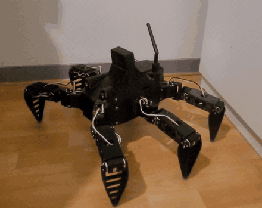

# Antares · robot hexapode

Robot marcheur à six pattes et 18 degrés de liberté, conçu comme base d'un robot de
secours en zone difficile. Conçu, fabriqué et programmé par Lucas Minaberry, élève ingénieur en mécatronique à l'ESILV (depuis juin 2026).

<p align="center"></p>

**[Documentation technique](https://lucas-minaberry.github.io/robot-hexapode/)**

*English summary below.*

## En bref

| | |
|---|---|
| Architecture | 6 pattes × 3 articulations, servomoteurs Feetech STS3215 sur bus série |
| Structure | Pièces imprimées en ASA, embouts de pieds en TPU |
| Énergie | Batterie LiPo 3S 5200 mAh, carte de distribution 12 V réalisée à la main |
| Calcul | Raspberry Pi 5, Ubuntu 24.04, ROS 2 Jazzy |
| Perception | Caméra de profondeur OAK-D SR, centrale inertielle BNO086 |
| Pilotage | Application sur téléphone, joystick, flux vidéo |
| Vitesse de marche | 120 mm/s mesurés, contre 50 mm/s au premier essai |

## Ce que couvre le projet

1. **Cahier des charges et dimensionnement** : couples articulaires, longueurs des segments,
   bilan de masse, choix des actionneurs.
2. **Conception mécanique** : CAO SolidWorks, conception orientée fabrication et assemblage,
   choix des matériaux.
3. **Électronique** : distribution de puissance, commutation des 18 servomoteurs,
   mesure de la batterie, séquences de marche et d'arrêt, études thermiques.
4. **Logiciel** : pilote des servomoteurs, génération de marche, jumeau numérique,
   application de pilotage, sécurités.
5. **Essais et optimisation** : quinze campagnes de mesure documentées, de l'identification
   de la flexion des pattes à l'optimisation de la démarche.
6. **Retours d'expérience** : incidents rencontrés, diagnostic et corrections.
7. **Phase 2** : marche adaptée au terrain, optimisation génétique de la démarche,
   commande vocale.

Chaque partie est détaillée dans la [documentation](docs/index.md).

## Méthode de travail

J'ai conduit ce projet seul, de la conception mécanique aux essais. Le logiciel a été
développé avec des agents de code IA : j'en ai défini l'architecture, les méthodes et les
critères de validation, j'ai diagnostiqué les défauts sur le robot et orienté les
corrections. Chaque évolution a été validée par des bancs d'essai et des mesures sur le
matériel. La page [Méthode](docs/07-methode.md) détaille cette organisation.

## Contenu du dépôt

```
docs/        documentation technique (publiée sur GitHub Pages)
code/        extraits du code : moteur de marche, cinématique, pilote des servomoteurs
electronique/ schéma électrique (sources KiCad)
```

---

## English summary

Antares is a six-legged walking robot with 18 degrees of freedom, intended as the base of a
search-and-rescue robot for difficult terrain. Designed, built and programmed by
Lucas Minaberry, mechatronics engineering student at ESILV (France). The project covers
mechanical sizing and CAD, power electronics, embedded software on a Raspberry Pi 5 with
ROS 2, a 3D digital twin, a smartphone control app, and fifteen documented test campaigns
that raised the walking speed from 50 to 120 mm/s. The software was built with AI coding
agents under my direction: I defined the architecture, methods and validation criteria,
and validated every change on the hardware. Documentation is in French.

Contact : lucas.minaberry@gmail.com · [LinkedIn](https://www.linkedin.com/in/lucas-minaberry-316698299)

---

© 2026 Lucas Minaberry. Documentation et médias sous licence
[CC BY-NC-ND 4.0](https://creativecommons.org/licenses/by-nc-nd/4.0/deed.fr) ;
code : tous droits réservés. Détails dans [LICENCE.md](LICENCE.md).
