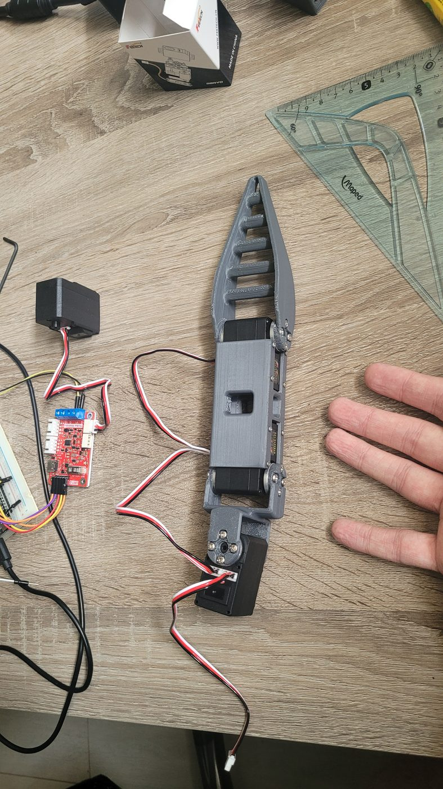
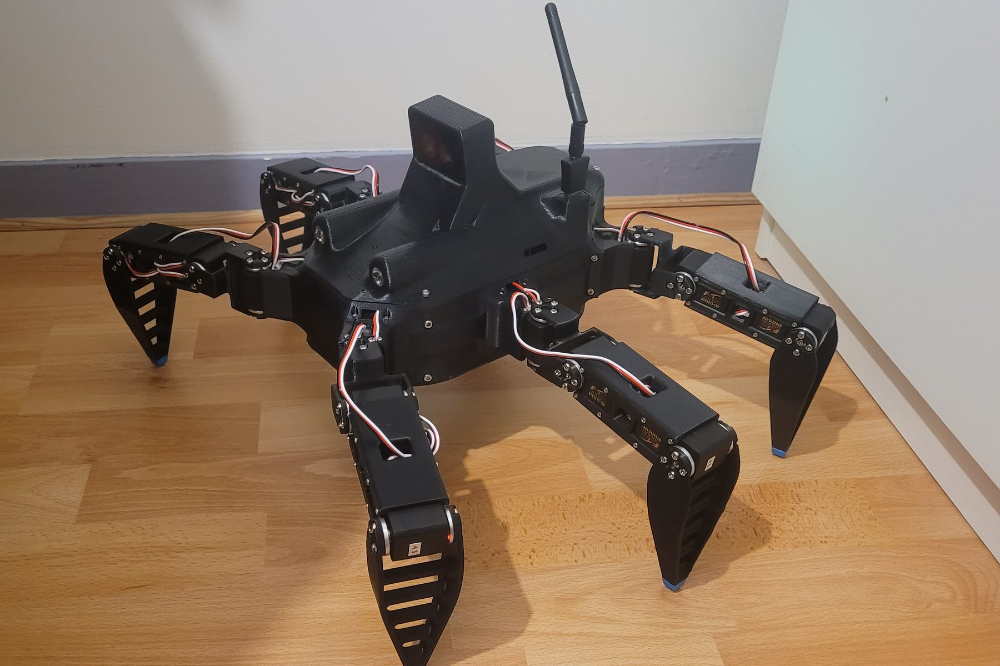
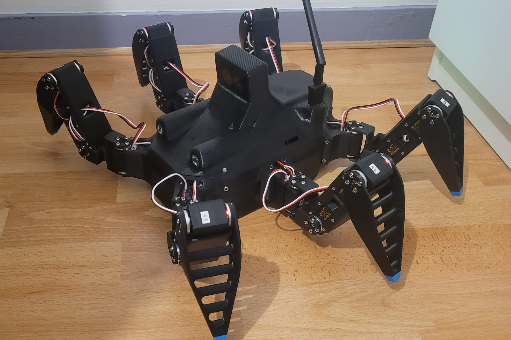

# 2. Conception mécanique

La structure est entièrement imprimée en 3D et conçue sous SolidWorks. Le fil
directeur est la **conception orientée fabrication et assemblage** : chaque pièce doit
s'imprimer sans difficulté, se monter simplement et rester accessible pour la
maintenance, sans sacrifier la rigidité.

<figure markdown>
<video controls muted loop playsinline preload="metadata" poster="../assets/videos/vue_eclatee.jpg" style="max-width:420px;width:100%">
  <source src="../assets/videos/vue_eclatee.mp4" type="video/mp4">
</video>
<figcaption>Vue éclatée animée, générée à partir du modèle 3D du robot.</figcaption>
</figure>

## Démarche

1. **Prototype d'une patte** avant tout le reste, pour valider les longueurs, les
   débattements et la tenue des liaisons servo / pièce.
2. **Placement des composants réels** dans la CAO (Raspberry Pi 5, caméra, cartes
   électroniques, batterie) à partir de leurs modèles constructeur, puis dessin du
   châssis autour d'eux. Figer une taille de châssis a priori aurait conduit à des
   reprises.
3. **Cotation fonctionnelle entre axes** : les dimensions qui gouvernent la marche
   (polygone d'appui, stabilité) se mesurent entre les axes de pivot des hanches, et non
   sur l'enveloppe extérieure de la coque.

<figure markdown>

<figcaption>Premier prototype de patte (juin 2026), monté sur banc avec sa carte de commande.</figcaption>
</figure>
<figure markdown>

<figcaption>Le robot assemblé : enceinte fermée, caméra en façade, antenne déportée.</figcaption>
</figure>

## Principes de conception

**Pièces monoblocs.** Chaque patte se compose de trois pièces imprimées, le châssis de
trois. Réduire le nombre de pièces supprime des interfaces vissées, qui sont à la fois
des sources de jeu, de temps de montage et de défaillance.

**Accessibilité.** Toutes les vis restent accessibles avec l'outil une fois le robot
assemblé. Les cartes électroniques sont montées sur connecteurs et non soudées sur la
carte support, ce qui permet de les retirer pour les reprogrammer ou les remplacer.

**Enceinte fermée.** L'électronique est enfermée dans le châssis. Le choix coûte de la
masse (le robot pèse 3,15 kg), mais protège les cartes de la poussière, des chocs et
des manipulations.

## Matériaux

| Matériau | Pièces | Raison du choix |
|---|---|---|
| ASA | Châssis, pattes, supports de composants | Rigidité, tenue en température nettement supérieure au PLA (les servomoteurs et les dissipateurs chauffent), résistance aux UV pour un usage extérieur |
| TPU 95A | Embouts de pieds, boutons | Adhérence au sol et amortissement des chocs au poser |

<figure markdown>
<video autoplay muted loop playsinline preload="metadata" poster="../assets/videos/montage_accelere.jpg" width="100%">
  <source src="../assets/videos/montage_accelere.mp4" type="video/mp4">
</video>
<figcaption>Le robot remonté, en accéléré : la vidéo de démontage passée à l'envers.</figcaption>
</figure>
<figure markdown>
<video autoplay muted loop playsinline preload="metadata" poster="../assets/videos/vue_eclatee.jpg" width="100%">
  <source src="../assets/videos/vue_eclatee.mp4" type="video/mp4">
</video>
<figcaption>Vue éclatée générée à partir du modèle 3D.</figcaption>
</figure>

## Intégration

<figure markdown>

<figcaption>Vue arrière : les dix-huit servomoteurs sont câblés patte par patte vers la carte de distribution.</figcaption>
</figure>

- **Câblage par patte** : chaque patte reçoit un seul connecteur trois points
  (alimentation, masse, données), les trois servomoteurs étant chaînés sur le bus.
- **Batterie** dans un logement dédié, débranchable par connecteur XT60 pour le stockage.
- **Caméra de profondeur** en façade, **antenne WiFi** déportée à l'extérieur de
  l'enceinte, **phares LED** avec dissipateurs intégrés à la coque
  ([étude thermique](03-electronique.md#phares-led)).

## Pistes d'amélioration

- **Adhérence des pieds** : les embouts en TPU 95A sont assez durs. Un TPU plus souple
  (85A) ou des patins en silicone augmenteraient le grip, en particulier sur sol lisse,
  où un pied qui glisse fausse aussi l'odométrie des pattes.
