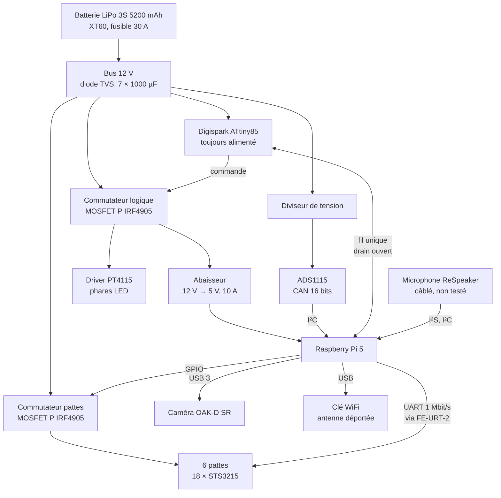
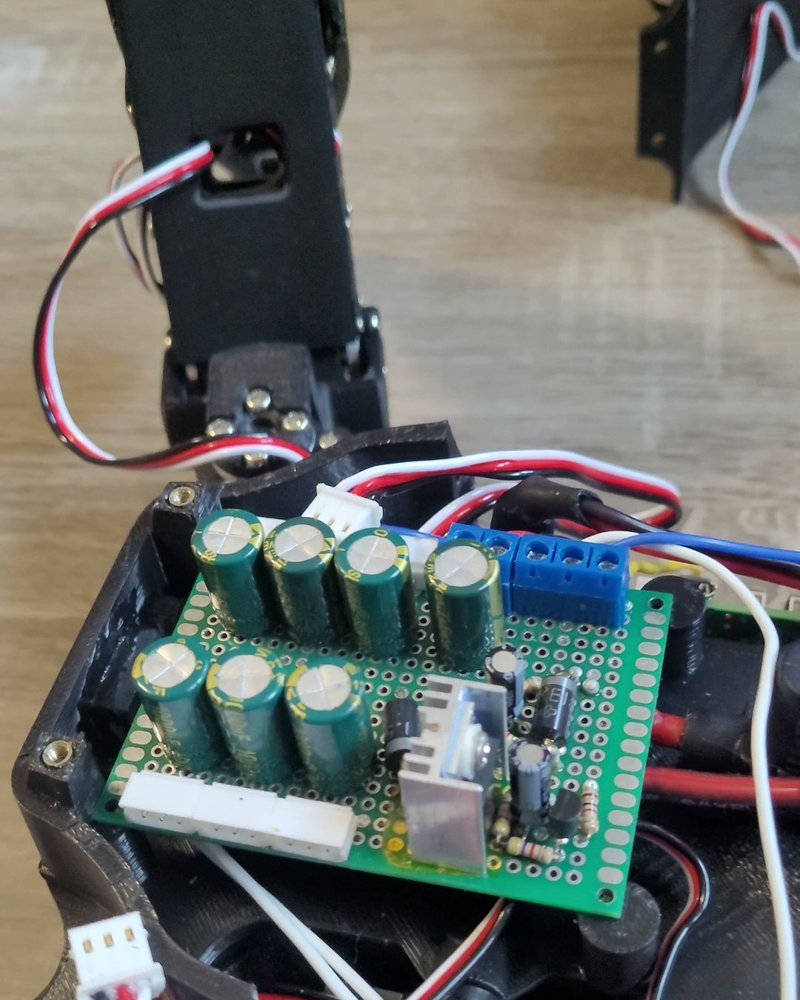
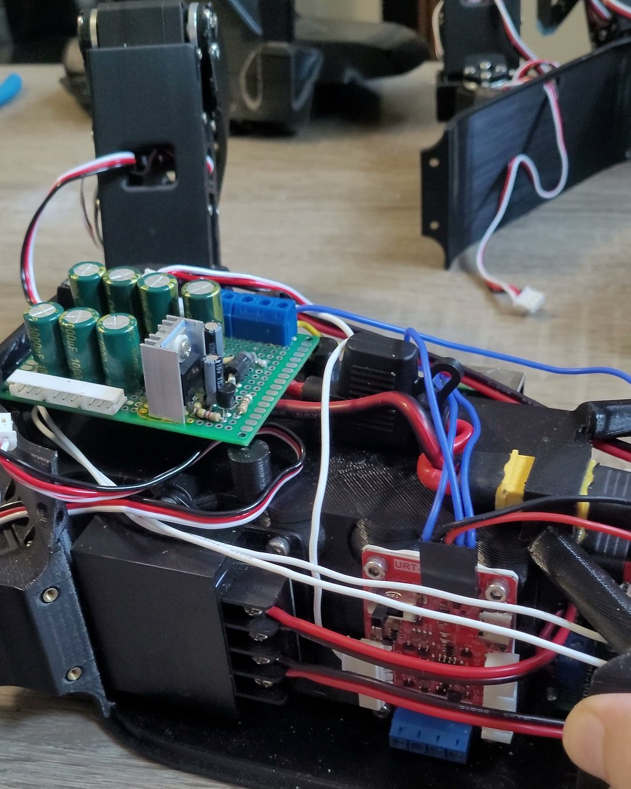
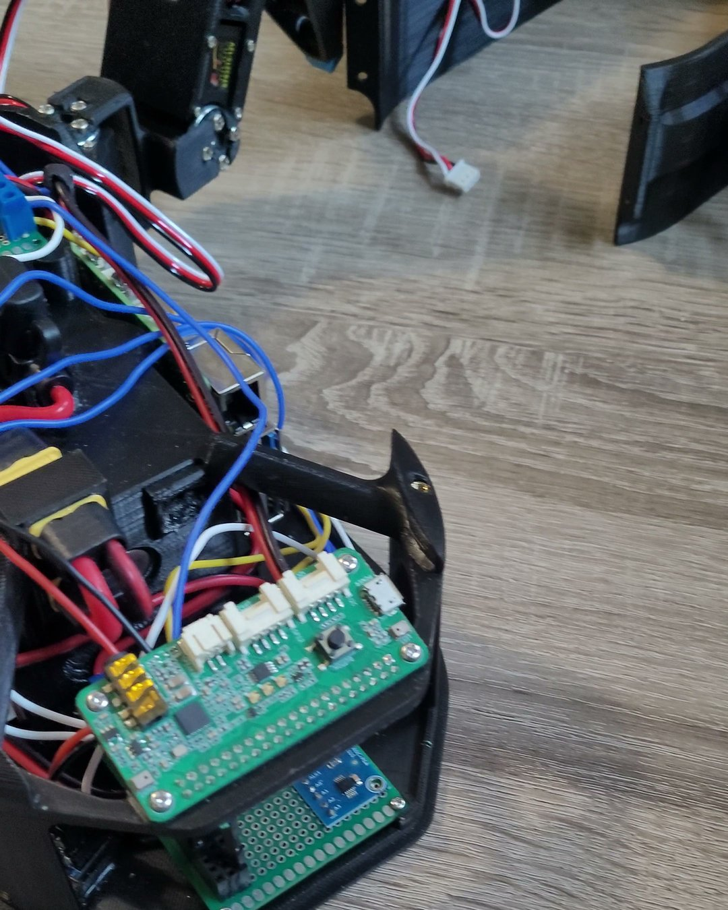
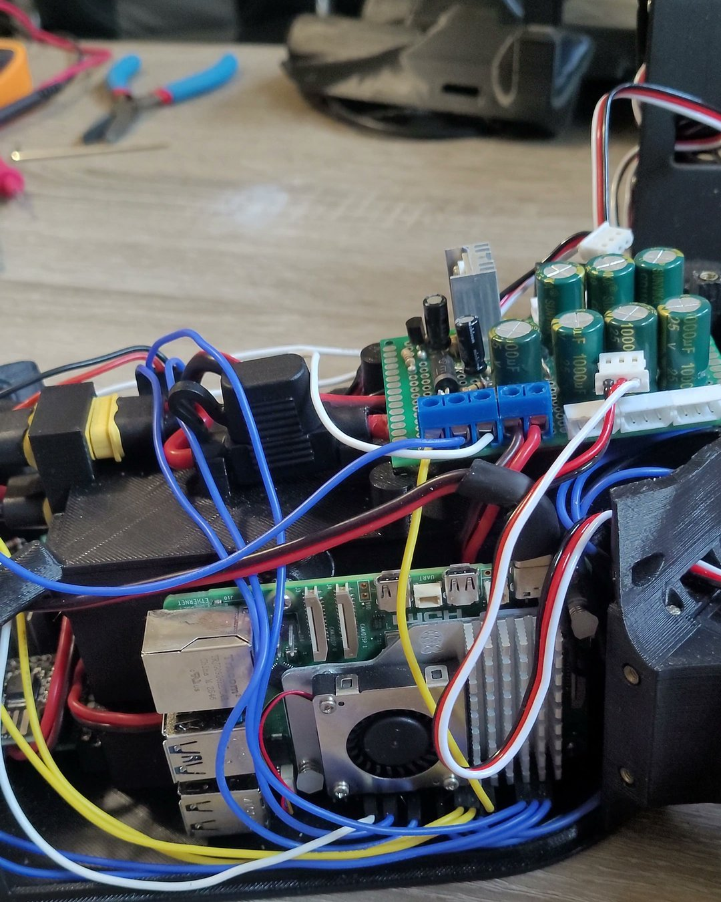
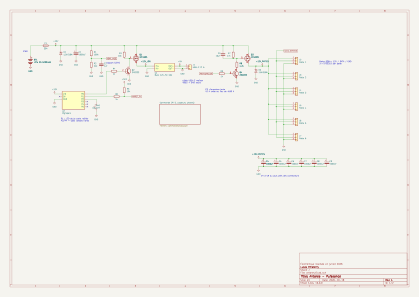
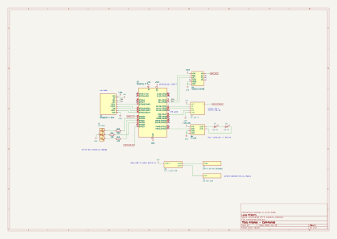

# 3. Électronique

L'électronique a été conçue, câblée et mise au point à la main, sur cartes à pastilles.
Elle répond à quatre exigences : alimenter dix-huit servomoteurs capables d'appeler
50 A ensemble, ne jamais activer les moteurs avant que le calculateur l'ait décidé,
surveiller la batterie, et pouvoir éteindre puis rallumer le robot par un simple bouton.

## Architecture

Le robot comporte ainsi trois domaines d'alimentation : le **bus 12 V permanent**
(protections, mesure, microcontrôleur de marche/arrêt), le **domaine logique** commuté
(calculateur, capteurs, phares) et le **domaine moteurs** commuté (les six pattes).

## Chaîne de puissance

<figure markdown>

<figcaption>Carte de distribution 12 V : condensateurs de découplage, départs vers les pattes, MOSFET sur dissipateur.</figcaption>
</figure>
<figure markdown>

<figcaption>L'enceinte ouverte : carte de puissance et câblage vers les pattes.</figcaption>
</figure>
<figure markdown>

<figcaption>Empilement à l'avant du robot : carte microphone au-dessus, carte logique et convertisseur ADS1115 en dessous.</figcaption>
</figure>
<figure markdown>

<figcaption>La Raspberry Pi 5 et son ventilateur, logée dans l'enceinte.</figcaption>
</figure>

| Élément | Choix | Justification |
|---|---|---|
| Fusible | Lame 30 A, sur le positif | Coupe un court-circuit franc ; une LiPo 3S peut débiter plus de 250 A |
| Diode TVS | 1.5KE18A, **après** le fusible | Écrête les surtensions ; une TVS en fin de vie meurt en court-circuit, et le fusible en amont protège alors la batterie |
| Découplage | 7 × 1000 µF faible ESR | Un condensateur par patte, un sur le bus |
| Sections | 12 AWG (tronc), 18 AWG (pattes) | Courant cumulé sur le tronc, courant d'une patte sur quelques centimètres |

**Bilan de courant.** Un STS3215 bloqué appelle 2,7 A : les dix-huit ensemble
représentent 48,6 A, un cas transitoire qui dimensionne le fusible et le commutateur.
En marche, l'appel moyen est estimé entre 6 et 15 A. La partie logique consomme 3,5 à
4 A sous 5 V en pointe, caméra comprise.

## Commutation des moteurs

Les servomoteurs ne sont alimentés que sur ordre du calculateur, et restent coupés
pendant tout le démarrage.

**Côté haut, et non côté masse.** Couper la masse des servomoteurs aurait laissé leur
ligne de données reliée à l'interface de bus, restée sous tension. Le courant aurait
alors pu remonter par les diodes de protection internes des circuits, qui auraient
alimenté partiellement les servomoteurs par leur broche de données. La règle retenue
pour tout le robot : dès qu'un signal reste connecté à une charge depuis un domaine
alimenté, la coupure se fait sur le positif.

**Choix du composant.** Cinq solutions ont été comparées avant de retenir un MOSFET canal
P **IRF4905** (74 A, \(R_{DS(on)}\) = 20 mΩ) :

| Solution | Verdict |
|---|---|
| MOSFET P IRF9540 (0,2 Ω) | Écarté : 500 W dissipés à 50 A |
| Six IRF9540, un par patte | Écarté : encombrement de la carte |
| Relais automobile 40 A | Écarté au profit d'une solution statique |
| MOSFET N IRLB8721, côté masse | Écarté : alimentation fantôme par la ligne de données |
| **MOSFET P IRF4905, côté haut** | **Retenu** : 8 W dissipés à 20 A, dissipateur TO-220 isolé |

**Commande de grille et démarrage progressif.** Un transistor NPN 2N2222 commandé par
une broche du calculateur tire la grille vers la masse. Un condensateur de 10 µF entre
grille et source ralentit l'ouverture du MOSFET, ce qui limite le courant de charge des
condensateurs des pattes et des servomoteurs (8 000 à 9 000 µF au total). Ce montage est
le résultat d'un incident, détaillé dans les
[retours d'expérience](06-retours-experience.md#le-mosfet-detruit-a-la-premiere-mise-sous-tension).

| Grandeur | Valeur |
|---|---|
| Tension grille-source en conduction | −11,3 V (pleine conduction, au-delà des −10 V de référence) |
| Courant d'appel à la fermeture | 42 A crête pendant 5 ms (contre environ 630 A sans démarrage progressif) |
| Puissance crête dans le MOSFET | 206 W pendant quelques ms, dans l'aire de sécurité du composant |
| Échauffement de jonction associé | environ 21 °C (impédance thermique transitoire à 5 ms) |
| Temps de coupure | environ 600 ms |

La coupure lente a une conséquence logicielle, respectée par le pilote : le couple des
servomoteurs est relâché **avant** la coupure du rail, jamais l'inverse.

## Alimentation du calculateur

Un abaisseur 12 V → 5 V de 10 A alimente la Raspberry Pi 5 par un câble USB-C
réalisé sur mesure : les fils de données sont retirés, et 15 cm de fil 18 AWG sont
soudés sur l'alimentation et la masse. Un second IRF4905, placé **en amont** de l'abaisseur, coupe d'un coup le calculateur et les
phares. Côté 12 V, le courant est 2,4 fois plus faible que côté 5 V : une même chute de
tension y est négligeable, alors qu'elle suffirait à faire redémarrer la Pi sur le 5 V.

La tension réellement vue par la Pi (mesurée par son régulateur interne) reste entre
**4,94 et 4,96 V** processeur à pleine charge, au-dessus du seuil d'alerte de 4,80 V.

## Mesure de la batterie

- **Convertisseur ADS1115** (16 bits, I²C), alimenté en **3,3 V** et non en 5 V : les
  résistances de tirage I²C du module sont reliées à son alimentation, et un bus à 5 V
  aurait exposé les entrées de la Pi, qui ne le tolèrent pas.
- **Diviseur de tension** étalonné (rapport 5,545 : 12,31 V lus 2,22 V), filtré par un
  condensateur.
- **Point de mesure après le fusible** : c'est la tension réellement disponible qui
  compte, et un fusible fondu se lit comme une chute brutale à 0 V, impossible à
  confondre avec une décharge.
- **Seuils** : alerte sous 3,60 V par élément, critique sous 3,45 V. À 20 % de charge,
  le rail des pattes est coupé après cinq lectures consécutives, et seulement une fois la
  séquence en cours terminée, pour que le robot se pose au lieu de s'effondrer.

## Marche et arrêt

La Raspberry Pi ne peut pas se rallumer seule : une fois hors tension, aucun logiciel
ne tourne. Un microcontrôleur **ATtiny85** (carte Digispark), alimenté en permanence par
le bus 12 V, surveille le bouton et commande le commutateur logique.

- **Allumage** : appui sur le bouton, le Digispark ferme le commutateur logique, la Pi
  démarre. Les moteurs restent coupés jusqu'à ce que la Pi les active.
- **Extinction** : appui maintenu une seconde, le Digispark envoie une impulsion de
  400 ms. La Pi relâche le couple, coupe les pattes et s'arrête proprement. Une fois
  la Pi éteinte, son 3,3 V disparaît et la ligne retombe à la masse : après 500 ms au
  niveau bas, le Digispark coupe l'alimentation. Si la Pi ne répond plus, une coupure
  de sécurité intervient après 90 s.
- **Un seul fil, dans les deux sens.** Le Digispark n'avait plus de broche libre, et
  fonctionne en 5 V quand les entrées de la Pi n'acceptent que 3,3 V. La liaison est
  donc en **drain ouvert**, comme un bus I²C : aucun des deux ne force le niveau haut,
  donné par une résistance de tirage vers le 3,3 V de la Pi. Aucune tension de 5 V ne
  peut atteindre la Pi. Autre avantage : quand la Pi est réellement éteinte, son 3,3 V
  disparaît et la ligne reste basse, ce qui confirme physiquement l'arrêt.

## Phares LED

Deux LED de puissance de 1 W sont alimentées par un driver à courant constant PT4115,
réglé à 345 mA, avec une gradation par la sortie PWM matérielle de la Pi. Une simple
résistance série aurait suffi, mais avec deux LED en série (environ 6,4 V) sous 12 V,
elle aurait dissipé près de la moitié de la puissance en chaleur dans l'enceinte : un
rendement d'environ 53 %. Un driver à découpage tient au contraire le courant constant
quelle que soit la charge de la batterie, et ne perd que ce que coûtent ses composants.
Estimation des pertes du module, avec des valeurs typiques pour ce type de circuit
(rapport cyclique \(D = 6{,}4/12 \approx 0{,}53\), courant 0,345 A) :

| Poste | Hypothèse | Pertes |
|---|---|---|
| Diode de roue libre | Schottky, 0,4 V pendant \(1-D\) | 0,065 W |
| Interrupteur intégré | 0,6 Ω pendant \(D\) | 0,04 W |
| Inductance | résistance de bobinage 0,3 Ω | 0,035 W |
| Résistance de mesure du courant | 0,1 V × 0,345 A | 0,035 W |
| Commutation et consommation propre | ordre de grandeur | 0,03 W |
| **Total** | | **environ 0,2 W** |

Pour 2,2 W transmis aux LED, le rendement estimé est d'environ **90 %**, cohérent avec
les 85 à 92 % annoncés pour ce type de driver. Le gain sur la résistance série est
d'environ 1,7 W de chaleur en moins dans l'enceinte (1,9 W dissipés par la résistance contre 0,2 W par le driver).

**Étude thermique.** Une première estimation avec un coefficient d'échange de manuel
(\(h\) = 10 W/m²·K) prédisait plus de 230 °C, un résultat manifestement faux. Le
coefficient a donc été **mesuré** : LED à pleine puissance à l'air libre pendant 40 min,
la plaque se stabilise à 65 °C pour 28 °C ambiants.

\[
h = \frac{Q}{A\,\Delta T} = \frac{1{,}1}{6{,}1\times10^{-4} \times 37} \approx 49\ \text{W/m}^2\text{K}
\]

soit cinq fois la valeur de manuel. Extrapolée au montage réel, où la LED est
partiellement noyée dans l'ASA (résistance thermique équivalente d'environ 76 K/W), la
température atteindrait 100 à 112 °C. Survivable pour une LED de puissance, mais au
détriment de sa durée de vie : un dissipateur à ailettes de 23 mm a été ajouté.

## Microphone

Une carte ReSpeaker à deux microphones est câblée sur la Pi. Seules les liaisons
utiles sont tirées (neuf fils : bus audio I²S, configuration du codec par I²C,
alimentations), ce qui laisse libres les autres broches du connecteur. Elle n'est pas
encore testée ; elle servira à la [commande vocale](08-phase-2.md#commande-vocale).

## Liaison radio

Le robot est à la fois point d'accès WiFi (pilotage en extérieur, sans infrastructure)
et client du réseau local. Une clé USB à antenne externe déportée hors de l'enceinte
porte la liaison ; comme la caméra, elle est branchée en USB sur la Pi. Un service bascule automatiquement entre la clé et la radio interne
de la Pi selon celle qui est présente. Le flux vidéo de la caméra (640 × 400 à 15 images/s,
environ 3,5 Mbit/s) est servi directement par la Pi, hors du canal de commande.

## Schéma

Le schéma complet tient sur deux feuilles : la puissance (batterie, protections, les
deux commutateurs, le convertisseur 5 V et la distribution vers les pattes) et la
commande (Raspberry Pi et ses périphériques). Il est disponible en
[PDF](annexes/schema_electrique.pdf), et ses sources KiCad sont dans le dossier
[`electronique/`](https://github.com/lucas-minaberry/robot-hexapode/tree/main/electronique)
du dépôt.

<figure markdown>

<figcaption>Feuille 1 : puissance. Cliquer pour agrandir.</figcaption>
</figure>

<figure markdown>

<figcaption>Feuille 2 : commande.</figcaption>
</figure>
