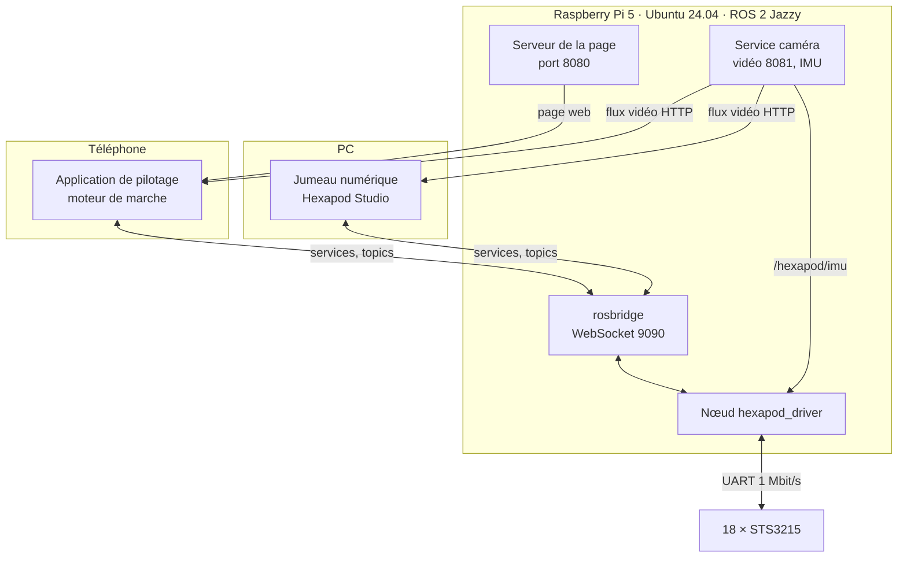
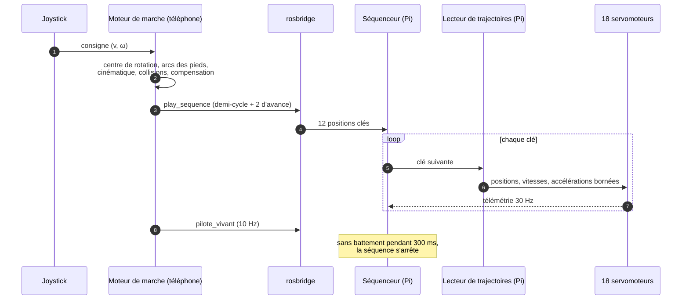

# 4. Logiciel

Le logiciel se répartit entre trois machines et trois programmes :

| Programme | Machine | Rôle |
|---|---|---|
| [Jumeau numérique](04a-jumeau-numerique.md) | PC (Electron, Three.js) | Assembler le robot à partir de la CAO, configurer ses moteurs, composer et simuler des animations, les envoyer au robot, mener les campagnes d'étalonnage |
| [Logiciel embarqué](04b-embarque-ros2.md) | Raspberry Pi 5 (ROS 2 Jazzy, Python) | Piloter les dix-huit servomoteurs, jouer les séquences de positions, gérer l'alimentation, les phares, la caméra et les sécurités |
| [Application de pilotage](04c-application-pilotage.md) | Téléphone (page web) | Faire marcher le robot au joystick : le moteur de marche calcule chaque pas en ligne |

Les trois partagent le même code pour ce qui doit donner le même résultat partout :
cinématique des pattes, moteur de marche, compensation de la flexion, conversion en
consignes de servomoteur. Une marche simulée dans le jumeau numérique ou prévisualisée
sur le téléphone est donc exactement celle que le robot recevra.

## Déploiement

La Pi sert elle-même la page de pilotage : un téléphone connecté au point d'accès du
robot n'a rien à installer. La vidéo passe par un flux HTTP séparé, jamais par le canal
de commande, pour qu'une image lourde ne retarde pas un ordre.

## Une marche, du joystick aux servomoteurs

La consigne n'est relue qu'une fois par demi-cycle, quand les six pieds sont au sol :
c'est le seul instant où changer de direction ne fait rien glisser.

## Tests hors ligne

Chaque brique critique dispose d'un banc qui tourne sans le robot. Aucune modification
de la marche, des trajectoires ou des sécurités n'est envoyée au robot sans que ses
bancs passent.

| Banc | Ce qu'il vérifie |
|---|---|
| Moteur de marche | 900 demi-cycles sur 90 consignes : glissement, butées, collisions, précision de la cinématique |
| Lecteur de trajectoires | Servomoteurs simulés d'après les traces du STS3215 : continuité, saccades, raccords entre demi-cycles |
| Sécurités | Chien de garde, basculement et batterie sur scénarios, puis sur une instance ROS simulée |
| Jumeau numérique | Scénario d'interface complet, fenêtre cachée, sur le vrai document du robot |
| Planificateur de la Pi porté sur PC | Durée réelle d'une marche avant de l'essayer : prévision confirmée à 3 % sur le robot |

## Code source

Des extraits du code (moteur de marche, cinématique, collisions, pilote des
servomoteurs, lecteur de trajectoires, sécurités) sont publiés dans le dossier
[`code/`](https://github.com/lucas-minaberry/robot-hexapode/tree/main/code) du dépôt ; ils sont listés en
[annexe](annexes/index.md#code-source).
