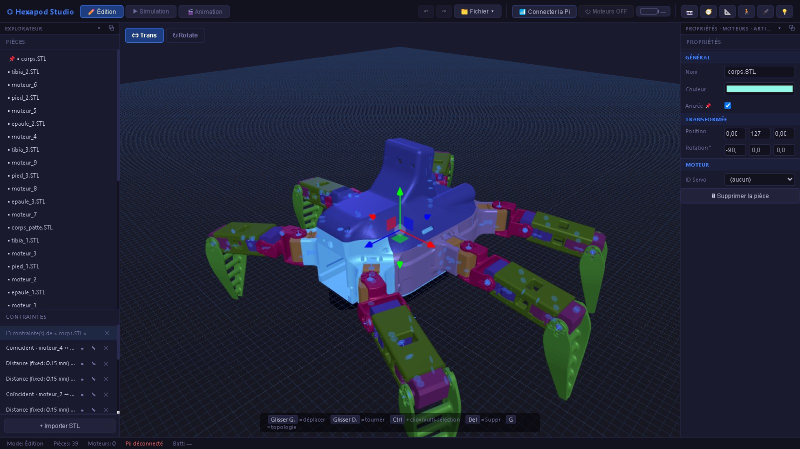
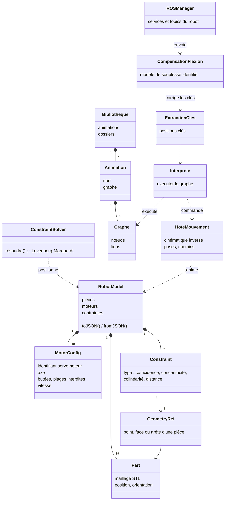

# 4.1 Jumeau numérique

**Hexapod Studio** est une application de bureau (Electron, Three.js) qui reconstruit le
robot à partir de sa CAO et sert d'atelier pour tout ce qui touche au mouvement : on y
assemble le robot, on y déclare ses moteurs, on y compose des animations, on les simule,
puis on les envoie au robot réel en suivant sa télémétrie.

<figure markdown>

<figcaption>Mode Édition : les 39 pièces exportées de SolidWorks, assemblées par contraintes géométriques.</figcaption>
</figure>

## Trois modes

| Mode | Usage |
|---|---|
| Édition | Importer les pièces (STL), les assembler par contraintes, déclarer les moteurs et leurs butées |
| Simulation | Manipuler les articulations à la souris, se connecter au robot, suivre sa télémétrie en temps réel |
| Animation | Composer des mouvements sous forme de graphes de blocs, les jouer sur le modèle puis sur le robot |

## Assemblage par contraintes

Les pièces arrivent de SolidWorks sous forme de maillages, sans aucune liaison. Elles
sont assemblées comme dans un logiciel de CAO : on désigne sur deux pièces un point,
une face ou une arête, et on impose une relation entre eux (**coïncidence**,
**concentricité**, **colinéarité** ou **distance**). Une concentricité munie d'un moteur
devient une articulation.

Le **solveur** traite l'assemblage comme un problème de moindres carrés :

- chaque pièce libre possède six degrés de liberté (trois en translation, trois en
  rotation) ; dans chaque groupe de pièces liées, une pièce est ancrée ;
- chaque contrainte produit des résidus à annuler ;
- le système est linéarisé par un jacobien numérique et résolu par la méthode de
  **Levenberg-Marquardt**, avec un amortissement adaptatif qui garantit un pas stable.

Les contraintes n'ont pas toutes le même poids. Un assemblage est une contrainte dure,
une butée d'articulation une contrainte molle. Quand les deux avaient le même poids, le
solveur avait le droit de désassembler le robot pour respecter une butée : l'assemblage
dérivait alors jusqu'à 3 mm et 18°. La hiérarchie des poids a supprimé ce défaut.

<figure markdown>
<video autoplay muted loop playsinline preload="metadata" poster="../assets/videos/logiciel_patte_construction.jpg" width="100%">
  <source src="../assets/videos/logiciel_patte_construction.mp4" type="video/mp4">
</video>
<figcaption>Assemblage d'une patte par contraintes, en accéléré.</figcaption>
</figure>
<figure markdown>
<video autoplay muted loop playsinline preload="metadata" poster="../assets/videos/logiciel_patte_resultat.jpg" width="100%">
  <source src="../assets/videos/logiciel_patte_resultat.mp4" type="video/mp4">
</video>
<figcaption>La patte assemblée : chaque articulation tourne autour de son axe.</figcaption>
</figure>

<figure markdown>
<video autoplay muted loop playsinline preload="metadata" poster="../assets/videos/logiciel_assemblage.jpg" width="100%">
  <source src="../assets/videos/logiciel_assemblage.mp4" type="video/mp4">
</video>
<figcaption>Le robot complet dans Hexapod Studio, pièce par pièce.</figcaption>
</figure>

## Moteurs

Chaque articulation motorisée porte sa configuration : identifiant du servomoteur sur
le bus, axe de rotation, butées, plages angulaires interdites (pour éviter qu'une patte
ne heurte le châssis) et vitesse. Les écritures de butées et de gains PID dans la
mémoire des servomoteurs se font depuis l'application et sont relues pour vérification.

## Animations par graphes de blocs

Une animation n'est pas une piste de positions datées : c'est un **graphe** de blocs
reliés, dans l'esprit des langages visuels des moteurs de jeu.

**Pourquoi pas une ligne de temps.** Un STS3215 ne suit pas une position instantanée :
il reçoit une position visée, une vitesse et une accélération, et construit lui-même sa
trajectoire. Une piste de positions datées permet d'écrire deux positions si rapprochées
qu'aucun servomoteur ne peut les relier, un mouvement visible à l'écran que le robot ne
fera jamais. Dans un graphe, on écrit une vitesse et une accélération, et la durée en
découle : tout ce qui s'écrit est réalisable.

| Famille | Blocs |
|---|---|
| Déroulement | début, attendre, séquence, en parallèle, rejoindre, boucle, si, jouer une animation |
| Mouvement | moteur vers un angle, point vers une position, aller à une pose, suivre un chemin, se lever ou se poser, relâcher |
| Données | nombre, vecteur, booléen, opération, comparaison, oscillation, interpolation, variable |

Le bloc **point vers** résout la cinématique inverse : on désigne un point nommé sur une
pièce (le bout d'un pied, par exemple) et la position qu'il doit atteindre. Le bloc
**jouer une animation** appelle un autre graphe comme un sous-programme : un pas est écrit
une fois et joué par les six pattes avec leur déphasage.

**Se lever et se poser depuis n'importe quelle pose.** Ces deux mouvements sont calculés
au moment du lancement, à partir de la pose réellement mesurée sur le robot, pour que
les pieds ne frottent pas au sol (moins de 0,15 mm de glissement sur quinze départs
simulés).

<figure markdown>
<video autoplay muted loop playsinline preload="metadata" poster="../assets/videos/logiciel_animation_graphe.jpg" width="100%">
  <source src="../assets/videos/logiciel_animation_graphe.mp4" type="video/mp4">
</video>
<figcaption>Construction d'une animation en graphe de blocs, en accéléré.</figcaption>
</figure>
<figure markdown>
<video autoplay muted loop playsinline preload="metadata" poster="../assets/videos/logiciel_animation_lecture.jpg" width="100%">
  <source src="../assets/videos/logiciel_animation_lecture.mp4" type="video/mp4">
</video>
<figcaption>L'animation jouée sur le modèle.</figcaption>
</figure>

## Du graphe au robot

Pour envoyer une animation, l'application l'exécute sur le modèle et en extrait des
**positions clés**. Ce calcul tourne dans un processus séparé pour ne pas figer
l'interface. Chaque clé passe ensuite par la compensation de la flexion, puis est
convertie en consignes de servomoteur (position, vitesse, accélération) et envoyée à la
Pi, qui la joue à son rythme.

Le robot n'est pas piloté au rythme de l'affichage : une clé n'est suivie de la suivante
que lorsque les articulations concernées l'ont atteinte. Une patte en retard retarde
ainsi la suite, au lieu de recevoir une nouvelle consigne avant d'avoir terminé la
précédente.

## Le jumeau en action

<figure markdown>
<video autoplay muted loop playsinline preload="metadata" poster="../assets/videos/digital_twin.jpg" width="100%">
  <source src="../assets/videos/digital_twin.mp4" type="video/mp4">
</video>
<figcaption>Le modèle et le vrai robot bougent ensemble (vidéo accélérée).</figcaption>
</figure>

## Modèle de données

Le robot, ses animations, ses réglages mécaniques et sa démarche sont enregistrés dans
un seul document JSON, avec historique d'annulation.

## Outils d'essai intégrés

- **Télémétrie** : position, charge, température et courant des dix-huit axes, en
  courbes, enregistrables pour l'analyse hors ligne.
- **Caméra et centrale inertielle** : le flux vidéo du robot et son inclinaison, avec
  l'étalonnage du zéro de l'IMU.
- **Étalonnage** : le déroulé guidé de la campagne de 40 poses qui a servi à identifier
  la souplesse des articulations ([Essais](05-essais.md#compensation-de-la-flexion)).
- **Démarche et réglages** : les paramètres de la marche au joystick et de la
  compensation, publiés vers l'application de pilotage.
