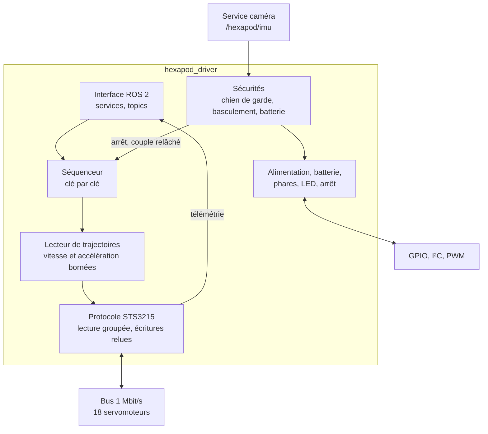
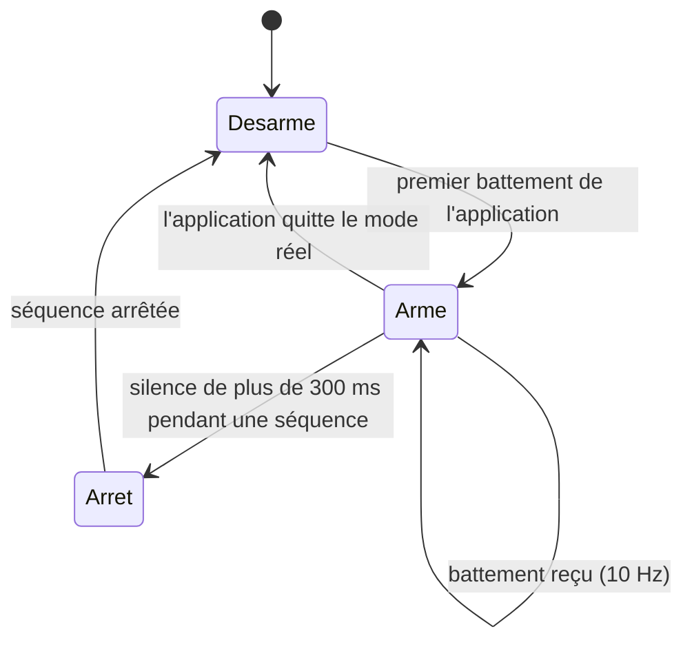

# 4.2 Logiciel embarqué (ROS 2)

La Raspberry Pi 5 exécute Ubuntu 24.04 et ROS 2 Jazzy. Le cœur est un nœud Python,
`hexapod_driver`, qui possède le bus des servomoteurs et tout le matériel de la carte :
alimentation des pattes, mesure de la batterie, phares, LED d'état, bouton d'arrêt. Il
est démarré par systemd au lancement de la Pi, à côté du service caméra, du serveur de
la page de pilotage et de rosbridge.

## Organisation du nœud

Le bus série et la configuration tournent dans deux fils d'exécution séparés : une
écriture en mémoire d'un servomoteur, lente, ne bloque plus le flux de télémétrie.

## Interface

| Type | Nom | Rôle |
|---|---|---|
| Service | `play_sequence`, `stop_sequence` | Jouer ou arrêter une séquence de positions clés |
| Service | `set_power`, `set_torque` | Alimentation des pattes, couple des servomoteurs |
| Service | `set_limits`, `get_limits`, `set_pid`, `get_pid` | Butées et gains PID, écrits en mémoire puis relus |
| Service | `recentrer` | Déplacer le zéro matériel d'un servomoteur |
| Service | `scan`, `get_position`, `set_stream` | Inventaire du bus, lecture ponctuelle, flux de télémétrie |
| Service | `set_lights`, `set_led` | Phares (0 à 100 %), LED d'état |
| Topic publié | `servo_states` | Position, vitesse, charge, température, courant des 18 axes, 30 Hz |
| Topic publié | `battery_state`, `power_state` | Tension et charge de la batterie, état du rail des pattes |
| Topic publié | `servo_limits`, `securite` | Butée réduite détectée, événements de sécurité |
| Topic souscrit | `set_position` | Consignes de position directes |
| Topic souscrit | `pilote_vivant` | Battement de l'application de pilotage |

Les messages et services sont définis dans un paquet d'interfaces dédié
(`hexapod_interfaces`).

## Protocole des servomoteurs

- **Lecture groupée** : position, vitesse, charge, tension, température et courant sont
  lus en une seule trame par servomoteur. Ajouter le courant a allongé chaque lecture de
  sept octets, soit 4 % de temps de bus en plus.
- **Écritures vérifiées** : la mémoire non volatile d'un STS3215 est protégée par un
  verrou, et deux écritures trop rapprochées peuvent se perdre. Chaque écriture est donc
  relue et comparée avant d'être déclarée réussie.
- **Tolérance aux pertes** : sur un bus half-duplex, une trame perdue ne prouve rien. Un
  servomoteur n'est déclaré incapable d'une lecture qu'après cinq échecs consécutifs,
  sans jamais perdre sa télémétrie de base.

## Séquenceur et trajectoires

Le **séquenceur** joue une séquence de positions clés sans horloge : dès que les
servomoteurs atteignent une clé, il commande la suivante. Un servomoteur asservi en
position freine à l'approche de sa cible ; lui donner la clé comme cible le ferait
ralentir à chaque clé, même quand le mouvement continue (319 freinages inutiles relevés
en 18 s de marche). Le séquenceur vise donc un point dans le prolongement du pas, dosé
selon l'alignement du pas suivant : le servomoteur traverse la clé lancé et reçoit la
direction suivante en y passant.

Le **lecteur de trajectoires** transforme chaque intervalle entre deux clés en courbes
monotones dont la vitesse et l'accélération restent sous les limites des servomoteurs
(2 800 pas/s et 90 000 pas/s²). Si une clé demande plus, sa durée est étirée. D'un
demi-cycle de marche au suivant, la trajectoire repart de la position, de la vitesse et
de l'instant réels, ce qui a supprimé l'arrêt que le robot marquait à chaque pas.

## Sécurités

| Organe | Seuil | Action |
|---|---|---|
| Chien de garde | 300 ms sans battement | Arrêt de la séquence en cours |
| Basculement | 30° tenus 0,3 s | Arrêt de la séquence |
| Renversement | 60° tenus 1 s | Couple relâché : les servomoteurs ne forcent pas dans le vide |
| Batterie | 20 % de charge | Coupure des pattes, différée jusqu'à la fin de la séquence pour que le robot se pose |
| Démarrage et arrêt | | Pattes hors tension pendant le démarrage ; couple relâché avant la coupure du rail |

Chaque organe est une petite machine à états qui ne fait que décider, séparée du nœud :
elle s'éprouve sur PC sans ROS ni matériel, puis sur une instance ROS simulée avant
d'être déployée. Une mesure d'inclinaison trop ancienne (service caméra arrêté) ne
déclenche rien.

## Service caméra

Un service séparé pilote la caméra OAK-D SR. Il publie la centrale inertielle sur
`/hexapod/imu` à environ 100 Hz et sert un flux vidéo compressé (640 × 400, 15 images/s,
environ 3,5 Mbit/s) directement en HTTP, hors de ROS.

## Déploiement

Le code est développé sur PC et déployé sur la Pi par un script unique, qui copie,
reconstruit l'espace de travail ROS 2 et relance les services. Le lecteur de
trajectoires et les sécurités ont chacun leur banc sur PC, à passer avant tout
déploiement qui les touche.
