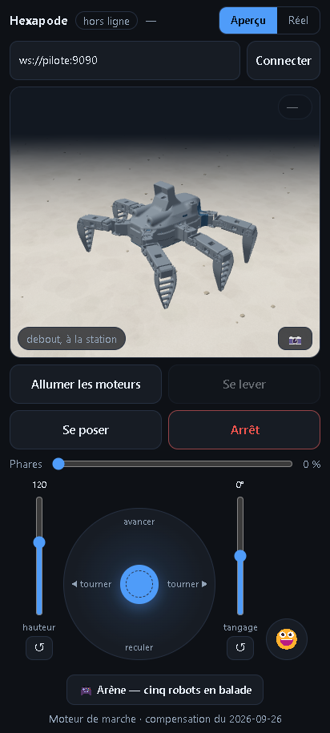
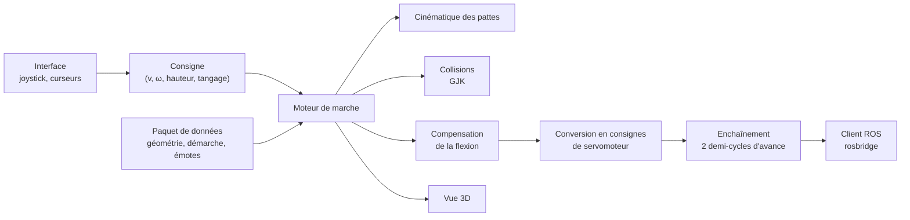

# 4.3 Application de pilotage

Une page web, servie par la Pi, qui fait marcher le robot au joystick depuis un
téléphone ou un PC, sans rien installer. Elle embarque le **moteur de marche** : chaque
pas est calculé en ligne, sur le téléphone, à partir de la consigne du joystick.

<figure markdown>
{ style="max-width:300px" }
<figcaption>Aperçu 3D, joystick, curseurs de hauteur et de tangage, phares.</figcaption>
</figure>
<figure markdown>
<video autoplay muted loop playsinline preload="metadata" poster="../assets/videos/robot_marche_terrasse.jpg" width="100%">
  <source src="../assets/videos/robot_marche_terrasse.mp4" type="video/mp4">
</video>
<figcaption>Marche au joystick : chaque pas est calculé en direct.</figcaption>
</figure>

## Animations jouées depuis l'application

<figure markdown>
<video autoplay muted loop playsinline preload="metadata" poster="../assets/videos/robot_coucou.jpg" width="100%">
  <source src="../assets/videos/robot_coucou.mp4" type="video/mp4">
</video>
<figcaption>Animation « Coucou » : une patte avant se lève et salue.</figcaption>
</figure>
<figure markdown>
<video autoplay muted loop playsinline preload="metadata" poster="../assets/videos/robot_assiette.jpg" width="100%">
  <source src="../assets/videos/robot_assiette.mp4" type="video/mp4">
</video>
<figcaption>Animation « Assiette » : le corps s'incline dans toutes les directions, pieds fixes.</figcaption>
</figure>

## Fonctions

| Commande | Effet |
|---|---|
| Aperçu / Réel | En aperçu, rien ne part vers le robot : la vue 3D montre ce qui partirait. En réel, les mêmes pas sont envoyés à la Pi |
| Allumer les moteurs | Alimentation des pattes, puis couple activé servomoteur par servomoteur |
| Se lever, se poser | Mouvements calculés depuis la pose réelle du robot, sans frotter les pieds au sol |
| Joystick | Marche en avant, en arrière, en virage ou sur place |
| Hauteur, tangage | Posture du corps pendant la marche |
| Phares | Intensité de 0 à 100 % |
| Émotes | Animations composées dans le jumeau numérique |
| Arrêt | Arrêt immédiat de la séquence en cours |

## Le moteur de marche

**Un centre de rotation plutôt qu'un choix d'animation.** Un corps qui avance à la
vitesse \(v\) en tournant à la vitesse \(\omega\) tourne, à chaque instant, autour d'un
point unique : le centre instantané de rotation, situé à \(R = v/\omega\) sur l'axe
latéral du robot. Le joystick place ce point : à l'infini pour aller tout droit, au
centre du robot pour pivoter sur place. Chaque pied au sol décrit un arc autour de lui,
et les six pieds suivent exactement le mouvement rigide du châssis. Avec les démarches
précalculées utilisées auparavant, où le pied suivait une corde, on mesurait 7,8 mm de
glissement par pas en virage ; ici, le glissement est nul par construction.

**Demi-cycle par demi-cycle.** La consigne est relue chaque fois que trois pieds viennent
de se poser, seul instant où les six sont au sol. Le moteur calcule le demi-cycle
suivant (douze positions clés) et en garde deux d'avance, pour que la Pi ne manque
jamais de trajectoire. La consigne ne peut pas varier de plus de 150 mm/s et 60 °/s d'un
demi-cycle au suivant.

**Ce que le moteur décide seul.** Il réduit l'amplitude du pas tant qu'un pied sort de
sa course utile, de ses butées ou de son espace atteignable. Il impose une distance
minimale de 105 mm entre les bouts de pieds, qui écarte les pattes voisines. La direction
demandée est toujours tenue : seule l'amplitude s'adapte.

**Collisions entre pattes.** Chaque segment de patte est représenté par deux
enveloppes : une boîte orientée, rapide, qui écarte les paires trop éloignées, puis son
enveloppe convexe exacte. La distance entre enveloppes est calculée par l'algorithme
**GJK**. Si deux pattes se touchent, le pas est raccourci. Avec l'écartement minimal des
pieds, ce contrôle n'est plus qu'un filet de sécurité.

**Cinématique en formule fermée.** Une patte se réduit à un axe vertical (la hanche) et
deux segments dans le plan qui tourne avec lui. Les angles s'obtiennent par
l'intersection de deux cercles, sans itération : assez rapide pour recalculer six pieds
douze fois par demi-cycle dans le navigateur d'un téléphone. La géométrie (positions des
axes, longueurs, sens de rotation) est mesurée sur le modèle 3D, jamais saisie à la
main, et vérifiée contre le solveur du jumeau numérique.

**Compensation de la flexion.** Chaque consigne est corrigée à l'envoi d'après le modèle
de souplesse identifié sur le robot
([Essais](05-essais.md#compensation-de-la-flexion)).

**Posture du corps.** Deux curseurs règlent la hauteur (57 à 158 mm) et le tangage
(±16,5°) du corps en marche. Les pieds sont calculés dans le repère du sol puis ramenés
dans celui du corps, qui rejoint sa cible par pas bornés. Le paquet de données de la page
contient l'enveloppe du châssis : si la garde au sol passe sous 20 mm, la hauteur
remonte d'elle-même.

## Composants de la page

Le moteur de marche, la cinématique, les collisions et la compensation sont les mêmes
modules que ceux du jumeau numérique : la page les embarque à la construction. Le paquet
de données (géométrie mesurée, paramètres de démarche, émotes précalculées) est produit
depuis le document du robot.

## Arène

Un mode « arène », sans connexion au robot, fait marcher cinq robots virtuels à la fois,
chacun avec sa propre consigne recalculée à chaque demi-cycle, pendant qu'on se déplace
entre eux. Il sert de banc de charge au moteur de marche : cinq robots calculés en temps réel
dans un navigateur représentent cinq fois la charge d'un pilotage normal.
