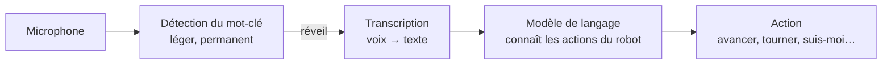

# 8. Phase 2

Antares marche de façon fiable depuis mi-septembre 2026 et a depuis été mis au point.
Pour devenir un robot de secours ([pourquoi ce robot](index.md#pourquoi-ce-robot)), la
phase suivante vise un robot qui **perçoit son terrain** et **comprend des ordres
donnés à la voix**, avec une démarche optimisée de façon systématique plutôt que réglée
à la main. Cette page décrit les chantiers prévus et l'ordre dans lequel ils
s'enchaînent ; rien de ce qui suit n'est encore réalisé, sauf mention contraire.

## Marche adaptée au terrain

L'objectif est une marche qui **pose chaque pied au bon endroit** : éviter un trou,
monter sur une bosse, contourner un obstacle. Elle reste statiquement stable. Une vraie
marche dynamique, avec des phases où le robot est en équilibre sur moins de trois
pieds, demanderait des actionneurs commandés en couple et une boucle de commande bien
plus rapide que ce que permettent des servomoteurs de position. Ce n'est pas l'objectif
de ce robot.

<figure markdown>
<video autoplay muted loop playsinline preload="metadata" poster="../assets/videos/robot_terrain_difficile.jpg" width="100%">
  <source src="../assets/videos/robot_terrain_difficile.mp4" type="video/mp4">
</video>
<figcaption>Aujourd'hui, sur un terrain en pente et irrégulier, la marche peine : les pieds se posent à l'aveugle.</figcaption>
</figure>

Les étapes, dans l'ordre :

1. **Estimation d'état** : fusionner l'odométrie des pattes (déjà utilisée pour mesurer
   la vitesse, [Essais](05-essais.md#instruments)) et la centrale inertielle pour savoir
   où est le robot et comment il est orienté.
2. **Détection de l'appui** : savoir quand un pied touche réellement le sol. Au rythme
   de lecture actuel des servomoteurs, le registre de charge seul ne suffit pas
   (mesuré). La question reste ouverte : en lisant les servomoteurs plus souvent, la
   courbe de charge pourrait suffire, associée à un modèle de classification. Des
   capteurs de contact provisoires sous les pieds serviront de vérité terrain pour
   entraîner et valider ce modèle, et pour décider s'ils doivent rester.
3. **Carte d'élévation locale** : la caméra de profondeur, recalée par l'estimation
   d'état, construit une carte 2,5D du sol autour du robot.
4. **Choix des appuis** : le moteur de marche remplace l'appui nominal de chaque pied par
   le meilleur point de la carte dans son voisinage. L'architecture du moteur le permet
   déjà : les appuis sont calculés un par un, demi-cycle par demi-cycle.

## Optimisation de la démarche

La démarche actuelle a été réglée par campagnes successives, un paramètre à la fois. La
suite est de l'optimiser globalement, sur une **matrice de critères** : vitesse,
énergie, couple maximal, régularité du corps, marge de stabilité.

1. **Simulation fidèle** : exporter le jumeau numérique vers un simulateur physique
   (MuJoCo), avec un modèle de servomoteur identifié sur les traces du robot : retard,
   limites de vitesse et d'accélération, souplesse. C'est le plus gros écart entre
   simulation et réalité, il doit être modélisé en premier.
2. **Validation** : comparer simulation et robot sur les campagnes existantes, et fixer
   un seuil d'écart en dessous duquel l'optimisation est digne de confiance.
3. **Robustesse** : faire varier aléatoirement masses, raideurs, frottement et retard
   dans la simulation, pour que la démarche retenue ne dépende pas d'un modèle exact.
4. **Optimisation multi-objectif** par algorithme génétique (NSGA-II) sur la dizaine de
   paramètres de la démarche. Le résultat est un front de Pareto, c'est-à-dire un
   ensemble de compromis, et non une seule solution.
5. **Répertoire par situation** : conserver les meilleures démarches indexées par
   situation (sol, pente, charge), et sélectionner la bonne en marche. L'approche
   s'inspire de travaux publiés sur un hexapode (Cully et al., *Nature*, 2015).

## Commande vocale

Le microphone (carte ReSpeaker à deux micros) est câblé sur la Pi, mais pas encore
testé. La chaîne prévue :

- Un processus léger écoute en permanence le **nom du robot** et ne réveille qu'alors
  la transcription, plus coûteuse. La Pi ne transcrit pas en continu.
- Le texte est envoyé par WiFi à un **modèle de langage** qui connaît la liste des
  actions du robot et leurs paramètres, et répond par une action : « avance de deux
  mètres », « tourne à gauche », « suis-moi ».
- Le **suivi de personne** s'appuie sur la caméra de profondeur, qui fournit à la fois
  la détection et la distance.
- Le bruit des servomoteurs et du vent est traité en logiciel (réseau de débruitage
  RNNoise), la carte micro n'embarquant plus d'algorithmes maintenus par son fabricant.

## Portage du moteur de marche sur la Pi

Aujourd'hui, le moteur de marche tourne dans l'application de pilotage, qui envoie
trois demi-cycles d'avance à la Pi. Le porter sur la Pi rendra le robot autonome vis-à-vis
du téléphone : c'est le prérequis de la navigation, de la commande vocale et du choix
des appuis, qui décideront tous depuis le robot.
