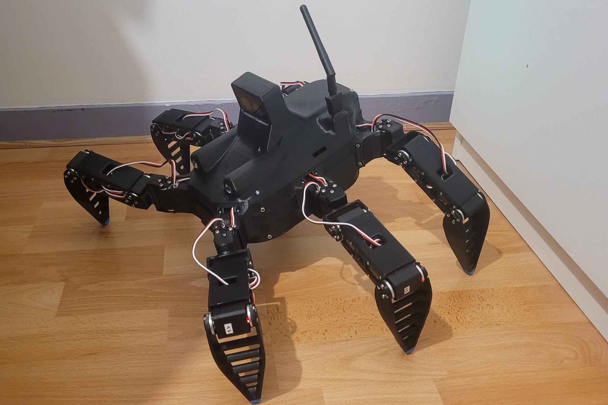
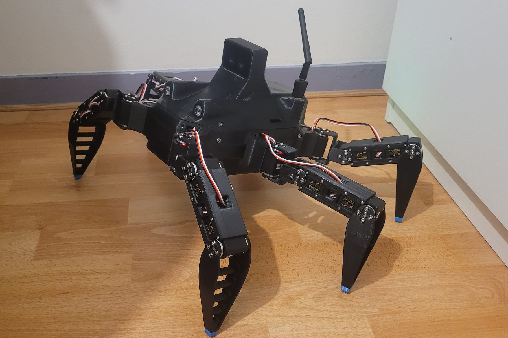

# Antares

**Antares** est un robot marcheur à six pattes et dix-huit degrés de liberté, conçu,
fabriqué et programmé seul. Commencé mi-juin 2026, il marche de façon fiable depuis mi-septembre, et sa
démarche a été optimisée depuis. Ce dossier décrit le projet de bout en bout : du
dimensionnement des articulations aux campagnes d'essais qui ont fait passer la vitesse
de marche de 50 à 120 mm/s.

<figure markdown>
<video controls playsinline preload="metadata" poster="assets/videos/antares_presentation.jpg" style="max-width:420px;width:100%">
  <source src="assets/videos/antares_presentation.mp4" type="video/mp4">
</video>
<figcaption>Présentation d'Antares en 3 minutes (son activé, sous-titres incrustés).</figcaption>
</figure>

<b>18</b>articulations, servomoteurs Feetech STS3215

<b>3,15 kg</b>masse en ordre de marche, enceinte fermée

<b>120 mm/s</b>vitesse de marche mesurée (50 mm/s au premier essai)

<b>15</b>campagnes d'essais documentées

## Pourquoi ce robot

Antares est pensé comme la base d'un **robot de secours en zone difficile** : un robot
capable d'atteindre une personne là où un véhicule à roues ne passe pas, pour lui porter
assistance.

L'hexapode s'est imposé pour trois raisons. Six pattes permettent une marche
statiquement stable, avec toujours trois pieds au sol : le robot reste en équilibre à
chaque instant, sans commande dynamique complexe, ce qui convient à un premier robot
marcheur. Chaque pied se pose indépendamment, ce qui ouvre la voie au franchissement de
terrains irréguliers. Enfin, des servomoteurs du commerce suffisent, ce qui le rend
accessible avec un petit budget.

| Étape | Capacité | État |
|---|---|---|
| 1 | Se déplacer piloté à distance, voir, éclairer et communiquer (vidéo, liaison radio longue portée) | Réalisé |
| 2 | Percevoir le terrain et se déplacer de façon autonome | En préparation ([Phase 2](08-phase-2.md)) |
| 3 | Transporter du matériel de premiers secours | Envisagé |

## Sur le terrain

<figure markdown>
<video autoplay muted loop playsinline preload="metadata" poster="assets/videos/robot_marche_terrasse.jpg" width="100%">
  <source src="assets/videos/robot_marche_terrasse.mp4" type="video/mp4">
</video>
<figcaption>Marche au joystick sur une terrasse.</figcaption>
</figure>
<figure markdown>
<video autoplay muted loop playsinline preload="metadata" poster="assets/videos/robot_nuit.jpg" width="100%">
  <source src="assets/videos/robot_nuit.mp4" type="video/mp4">
</video>
<figcaption>De nuit, phares allumés : la LED verte indique que le robot est prêt.</figcaption>
</figure>

## Le système

| Sous-ensemble | Réalisation |
|---|---|
| Structure | Pièces imprimées en ASA, embouts de pieds en TPU, conception SolidWorks |
| Actionneurs | 18 servomoteurs STS3215 (2,9 N·m de couple de blocage sous 12 V) sur un bus série à 1 Mbit/s |
| Énergie | Batterie LiPo 3S 5200 mAh ; carte de distribution 12 V avec protection, commutation des pattes et mesure de tension |
| Calcul | Raspberry Pi 5, Ubuntu 24.04, ROS 2 Jazzy |
| Perception | Caméra de profondeur OAK-D SR avec centrale inertielle BNO086 |
| Interfaces | Jumeau numérique 3D sur PC ; application de pilotage sur téléphone (joystick, vidéo, phares) |

<figure markdown>

</figure>
<figure markdown>

</figure>

## Chronologie

| Période | Travail |
|---|---|
| Début juin 2026 | Idée, premier choix des composants, dimensionnement |
| Fin juin, début juillet | Prototype d'une patte (modélisé, imprimé, monté) ; début du jumeau numérique pour le piloter |
| Juillet | Électronique interne : carte de puissance, commutation, mesure de la batterie ; nouvelles fonctions du logiciel |
| Août | Conception et impression du corps, finition de l'électronique, assemblage complet du robot |
| Début septembre | Corrections et réparations, logiciel minimal pour faire marcher le robot |
| Septembre à aujourd'hui | Moteur de marche, application de pilotage, campagnes d'essais et optimisation |

La mécanique, l'électronique et le logiciel ont avancé en parallèle, parce que chacun
contraint les autres : l'électronique fixe le volume du corps, le corps fixe
l'implantation des pattes et des moteurs, et les moteurs imposent à leur tour
l'électronique de puissance. La conception a donc procédé par itérations successives
sur l'ensemble plutôt que sous-système par sous-système.

## Parcours du dossier

1. **[Dimensionnement](01-dimensionnement.md)** : charges par patte, couple admissible,
   choix des servomoteurs et des longueurs de segments, puis comparaison avec les couples
   mesurés sur le robot.
2. **[Conception mécanique](02-mecanique.md)** : conception orientée fabrication et
   assemblage, matériaux, intégration des composants.
3. **[Électronique](03-electronique.md)** : architecture d'alimentation, commutation
   des servomoteurs, mesure de la batterie, marche et arrêt, études thermiques.
4. **[Logiciel](04-logiciel.md)** : pilote des servomoteurs, génération de marche en
   ligne, jumeau numérique, application de pilotage, sécurités.
5. **[Essais et optimisation](05-essais.md)** : méthode, instruments de mesure et
   résultats des campagnes sur le robot.
6. **[Retours d'expérience](06-retours-experience.md)** : incidents rencontrés,
   diagnostic et corrections.
7. **[Méthode de travail](07-methode.md)** : organisation du projet et place des agents
   de code IA.
8. **[Phase 2](08-phase-2.md)** : marche adaptée au terrain, optimisation de la démarche,
   commande vocale.

## Auteur

Lucas Minaberry, élève ingénieur en mécatronique (4e année, ESILV, majeure
Industrie et Robotique). À la recherche d'un stage de 4 à 5 mois à partir d'avril 2027.
[lucas.minaberry@gmail.com](mailto:lucas.minaberry@gmail.com) ·
[LinkedIn](https://www.linkedin.com/in/lucas-minaberry-316698299)
